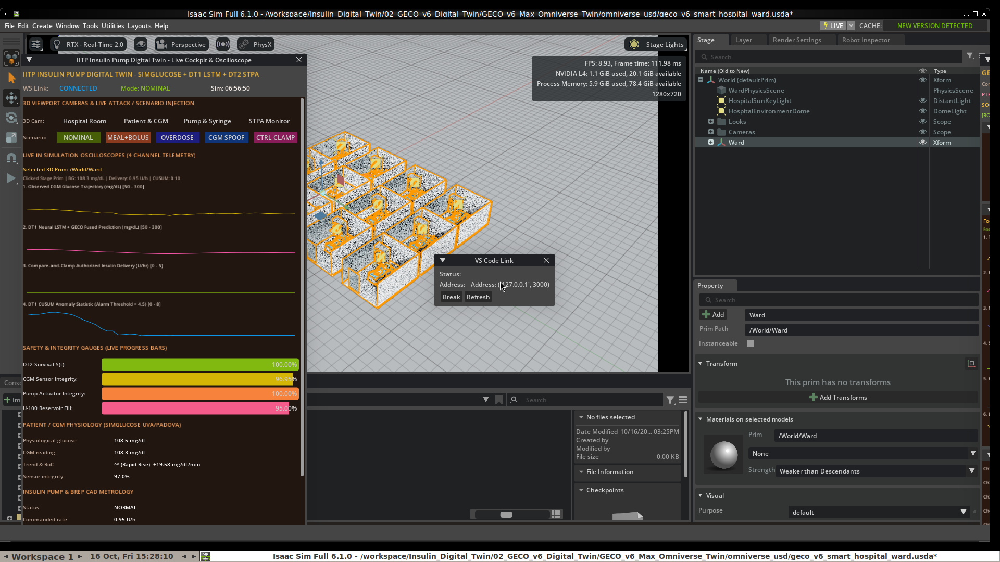
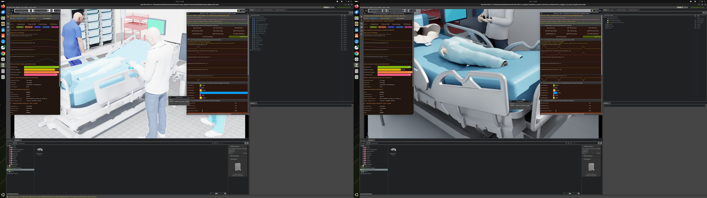

# Cloud Deployment & Local Operations Guide

This guide provides step-by-step instructions for deploying, streaming, and operating both Insulin Pump Digital Twin platforms on **Runpod GPU Cloud**, **NVIDIA Omniverse Nucleus Cloud**, and **Local Linux GPU Workstations**.

---

## 1. Architecture Overview

The repository hosts two complementary cyber-physical digital twins built on **NVIDIA Omniverse Isaac Sim 6.1.0** and **OpenUSD**:

1. **`01_IIT_Patna_Insulin_Pump_Digital_Twin` (Single-Room ICU Digital Twin)**
   - **3D OpenUSD Stage**: `Assets/HospitalRoom.usd` and `Assets/Models/hospital_digital_twin.usda`
   - **Articulated 3D Clinical Characters (`UsdSkel`)**: Supine ICU Patient (`Human_Patient_Supine.usd`), Attending Physician (`Human_Doctor.usd`), ICU Clinical Nurse (`Human_Nurse.usd`), and Biomedical Telemetry Engineer (`Human_Engineer.usd`), plus 4K PBR hospital bed, infusion stand, bedside telemetry monitor, supply cart, and cabinet props.
   - **Closed-Loop Physiological & Security Engine (`:8765`)**: UVA/Padova & Hovorka ODE solver (`simglucose`), DT1 LSTM/GRU/Transformer sequence predictor + CUSUM residual anomaly detector, DT2 STPA Unsafe Control Action runtime monitor + Weibull hazard/survival estimator, and Compare-and-Clamp safety arbiter.
   - **Native `omni.ui` Cockpit**: Docked directly inside the Isaac Sim viewport (`iitp/digital_twin/websocket/ui.py`).

2. **`02_GECO_v6_Digital_Twin` (GECO v6.1+ 12-Bay Smart Hospital Ward Digital Twin)**
   - **3D OpenUSD Stage**: `GECO_v6_Max_Omniverse_Twin/omniverse_usd/geco_v6_smart_hospital_ward.usda`
   - **12-Bay Ward Topology**:
     - **Bays 1–10 (`P01`–`P10`)**: 10 concurrent Type-1 Diabetes patient bays, each equipped with a 9-subsystem articulated insulin infusion hardware stack (borosilicate syringe barrel, dynamic teal U-100 fluid column, TR8x2 lead-screw plunger carriage, fail-safe pinch valve, 60 cm PTFE microbore catheter, Dexcom G7 CGM pod, Li-Ion + supercapacitor hold-up module, and Simplex safety gateway) and articulated clinical staff (`UsdSkel`).
     - **Bay 11**: 138-part High-Precision Gravimetric & Optical Metrology Rig (`geco_v6_metrology_rig.usda`).
     - **Bay 12**: IEEE-1588v2 PTP Grandmaster Clock Rack & 10 Hz Optical Sync Strobe (`±0.2 ms` synchronization across bays).
   - **7-State Nonlinear Hovorka ODE + Extended Kalman Filter (`:8766`)**: Real-time state estimation (`hovorka_ekf_twin.py`) and ward telemetry server (`ward_telemetry_server.py`).
   - **Native `omni.ui` Ward Cockpit**: Multi-patient telemetry, safety clamping, and fault-injection controls docked inside Isaac Sim (`isaac_extension/ward_ui.py`).

---

## 2. Cloud Deployment on Runpod GPU Pod (24/7 Cloud Streaming)

Deploying on a cloud GPU pod allows the entire simulation stack—both telemetry servers, the Omniverse Nucleus USD Cloud Portal, and two concurrent NVIDIA Isaac Sim 6.1.0 RTX viewports—to run continuously in the cloud so team members can inspect and interact with the twins from any browser without keeping a local workstation powered on.



### Step 2.1: Provision the GPU Pod

1. Log in to [Runpod](https://www.runpod.io/console/pods) and deploy a **GPU Pod**:
   - **Recommended GPU**: `NVIDIA RTX 4090 (24 GB VRAM)`, `RTX A6000 (48 GB VRAM)`, or `L40S (48 GB VRAM)`
   - **Container Image**: `runpod/pytorch:2.4.0-py3.11-cuda12.4.1-devel-ubuntu22.04`
   - **Persistent Volume**: `50 GB` mounted at `/workspace`
   - **Exposed HTTP Proxy Ports**: `6080, 8090, 8765, 8766`
   - **Exposed TCP Ports**: `22` (SSH)

| Port | Service | Cloud Proxy URL Pattern |
|---|---|---|
| `6080` | **3D Interactive Cloud Desktop (NoVNC)** running both Isaac Sim 6.1.0 windows | `https://<POD_ID>-6080.proxy.runpod.net/vnc.html?autoconnect=true&resize=scale` |
| `8090` | **Omniverse Nucleus Cloud USD Portal & HTTP Stage Server** | `https://<POD_ID>-8090.proxy.runpod.net/` |
| `8765` | **Twin #1 (IIT Patna) Live WebSocket Telemetry Server** | `wss://<POD_ID>-8765.proxy.runpod.net` |
| `8766` | **Twin #2 (GECO v6.1+) 12-Bay Ward WebSocket Telemetry Server** | `wss://<POD_ID>-8766.proxy.runpod.net` |

### Step 2.2: Clone the Repository on the Cloud Pod

SSH into the Runpod instance and clone this repository into `/workspace`:

```bash
cd /workspace
git clone https://github.com/RishabhGautam22/Insulin-Pump-Digital-Twin.git
cd /workspace/Insulin-Pump-Digital-Twin
```

### Step 2.3: Install System Display Packages & NVIDIA Isaac Sim 6.1.0

Run the following setup commands on the pod to install the virtual X11/Vulkan desktop stack (`Xvfb`, `fluxbox`, `x11vnc`, `novnc`) and NVIDIA Isaac Sim 6.1.0 in `/workspace/isaacsim`:

```bash
apt-get update && apt-get install -y \
    xvfb fluxbox x11vnc novnc websockify \
    libglu1-mesa libxi6 libxrender1 libxrandr2 libxcursor1 \
    libxinerama1 libxxf86vm1 libatomic1 vulkan-tools mesa-vulkan-drivers

# Install uv and create a dedicated Python 3.11 virtual environment for Isaac Sim 6.1.0
curl -LsSf https://astral.sh/uv/install.sh | sh
export PATH="$HOME/.local/bin:$PATH"

mkdir -p /workspace/isaacsim
cd /workspace/isaacsim
uv venv --python 3.11 .venv
source .venv/bin/activate

uv pip install "isaacsim[all,extscache]==6.1.0.0" \
    --extra-index-url https://pypi.nvidia.com \
    websockets pyyaml numpy scipy pandas
```

### Step 2.4: Launch the Cloud Stack (Telemetry + Nucleus Cloud Portal + Dual Isaac Sim Viewports)

Run the cloud startup sequence inside the pod:

```bash
export DISPLAY=:99
export OMNI_KIT_ACCEPT_EULA=YES

# 1. Start virtual 1080p RTX display, window manager, VNC, and NoVNC (:6080)
Xvfb :99 -screen 0 1920x1080x24 +extension GLX +render -noreset &
sleep 2
fluxbox &
x11vnc -display :99 -forever -shared -nopw -rfbport 5900 -bg
websockify --web=/usr/share/novnc/ 6080 localhost:5900 &

# 2. Start Twin #1 (IIT Patna) Live Closed-Loop Telemetry Server (:8765)
cd /workspace/Insulin-Pump-Digital-Twin/01_IIT_Patna_Insulin_Pump_Digital_Twin
/workspace/isaacsim/.venv/bin/python3 digital_twin_server.py --live --host 0.0.0.0 --port 8765 > /tmp/twin1_server.log 2>&1 &

# 3. Start Twin #2 (GECO v6.1+) 12-Bay Ward Live Telemetry Server (:8766)
cd /workspace/Insulin-Pump-Digital-Twin/02_GECO_v6_Digital_Twin/GECO_v6_Max_Omniverse_Twin
/workspace/isaacsim/.venv/bin/python3 -m geco_v6_max.ward_telemetry_server --host 0.0.0.0 --port 8766 > /tmp/twin2_server.log 2>&1 &

# 4. Launch Twin #1 in NVIDIA Isaac Sim 6.1.0
cd /workspace/Insulin-Pump-Digital-Twin/01_IIT_Patna_Insulin_Pump_Digital_Twin
./run_extension.sh &

# 5. Launch Twin #2 in NVIDIA Isaac Sim 6.1.0
cd /workspace/Insulin-Pump-Digital-Twin/02_GECO_v6_Digital_Twin/GECO_v6_Max_Omniverse_Twin
./run_geco_extension.sh &
```

Once launched, open `https://<POD_ID>-6080.proxy.runpod.net/vnc.html?autoconnect=true&resize=scale` in any web browser to view and control both live 3D Isaac Sim simulations.

---

## 3. Omniverse Nucleus Cloud USD Stage Hosting & Remote Client Connection

Both projects support loading their OpenUSD stages and textures directly over HTTP/HTTPS or `omniverse://` URIs so remote workstations can stream the 3D assets from the cloud without local asset duplication.

### Step 3.1: Stage Assets for Nucleus Cloud

```bash
# Stage Twin #1 (IIT Patna) USD hierarchy
cd 01_IIT_Patna_Insulin_Pump_Digital_Twin
python3 cloud_deployment/upload_to_nucleus.py --mode stage-only

# Stage Twin #2 (GECO v6.1+) USD hierarchy
cd ../02_GECO_v6_Digital_Twin/GECO_v6_Max_Omniverse_Twin
python3 cloud_deployment/upload_geco_v6_to_nucleus.py --mode stage-only
```

### Step 3.2: Connect Any Remote Isaac Sim Client to the Cloud Stage & Telemetry

From any workstation with NVIDIA Isaac Sim installed, point the environment variables at your cloud pod or Nucleus server:

```bash
# Connect Twin #1 to Cloud USD Stage & Cloud WebSocket Telemetry
export IITP_NUCLEUS_STAGE_URI="https://<POD_ID>-8090.proxy.runpod.net/Projects/IITP_Insulin_Digital_Twin/Assets/HospitalRoom.usd"
export IITP_WS_URI="wss://<POD_ID>-8765.proxy.runpod.net"
cd 01_IIT_Patna_Insulin_Pump_Digital_Twin && ./run_extension.sh

# Connect Twin #2 to Cloud USD Stage & Cloud WebSocket Telemetry
export GECO_NUCLEUS_STAGE_URI="https://<POD_ID>-8090.proxy.runpod.net/Projects/GECO_v6_Max/omniverse_usd/geco_v6_smart_hospital_ward.usda"
export GECO_WS_URI="wss://<POD_ID>-8766.proxy.runpod.net"
cd 02_GECO_v6_Digital_Twin/GECO_v6_Max_Omniverse_Twin && ./run_geco_extension.sh
```

---

## 4. Local Workstation Execution



### Step 4.1: Launch Twin #1 (IIT Patna Insulin Pump Digital Twin) Locally

```bash
cd 01_IIT_Patna_Insulin_Pump_Digital_Twin

# Start the live closed-loop SimGlucose + DT1/DT2 telemetry server on ws://127.0.0.1:8765
./run_server.sh --live &

# Launch NVIDIA Isaac Sim with the IIT Patna ICU Hospital Room & native omni.ui cockpit
./run_extension.sh
```

### Step 4.2: Launch Twin #2 (GECO v6.1+ 12-Bay Smart Hospital Ward) Locally

```bash
cd 02_GECO_v6_Digital_Twin/GECO_v6_Max_Omniverse_Twin

# Start the 12-Bay Hovorka EKF + PTP Master Clock telemetry server on ws://127.0.0.1:8766
./run_geco_server.sh &

# Launch NVIDIA Isaac Sim with the 12-Bay Smart Hospital Ward & native omni.ui cockpit
./run_geco_extension.sh
```

### Step 4.3: Run Automated Verification Suites

```bash
# Run Twin #1 test suite (118 unit and property-based tests)
cd 01_IIT_Patna_Insulin_Pump_Digital_Twin
pytest tests/ -v

# Run Twin #2 test suite (Hovorka EKF, 12-Bay Ward Telemetry, and GECOv6 verification)
cd ../02_GECO_v6_Digital_Twin/GECO_v6_Max_Omniverse_Twin
pytest tests/ -v
```

### Step 4.4: Safe Shutdown of All Local Servers

```bash
pkill -f "digital_twin_server.py" || true
pkill -f "ward_telemetry_server" || true
pkill -f "geco_omniverse_server.py" || true
pkill -f "isaacsim" || true
```
