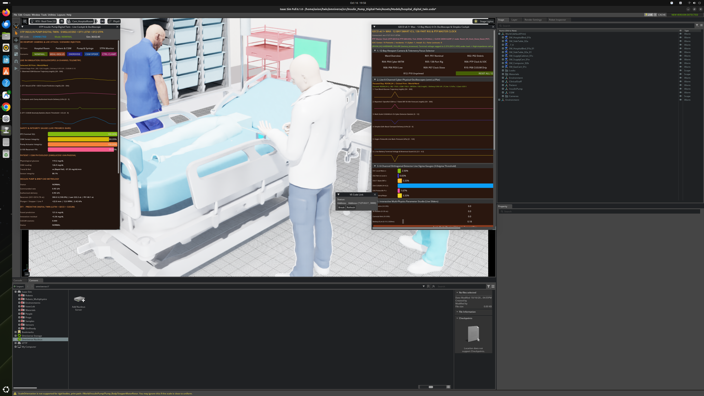
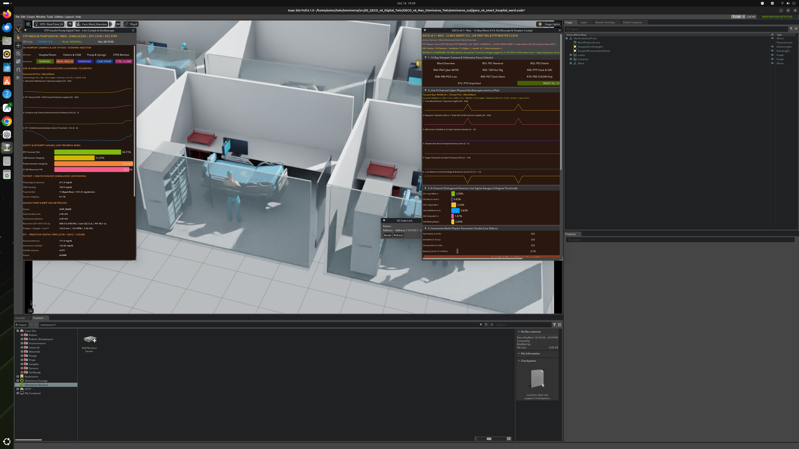

# Cyber-Physical Insulin Pump Digital Twin Suite (NVIDIA Omniverse & Isaac Sim 6.1.0)

This repository contains two complete cyber-physical **Insulin Pump Digital Twin** platforms built on **NVIDIA Omniverse Isaac Sim 6.1.0**, **OpenUSD**, and real-time physiological/security closed-loop simulation engines:

1. **[`01_IIT_Patna_Insulin_Pump_Digital_Twin`](./01_IIT_Patna_Insulin_Pump_Digital_Twin)** — **IIT Patna Single-Room ICU Closed-Loop Insulin Pump Digital Twin**
   - Real-time UVA/Padova & Hovorka Type-1 Diabetes physiological simulation (`simglucose`) coupled with a dual-layer security architecture: **DT1** (`LSTM` / `GRU` / `Transformer` sequence forecasting + `CUSUM` residual detector) and **DT2** (`STPA` Unsafe Control Action runtime monitor + `Weibull` reliability hazard/survival estimator + `Compare-and-Clamp` hardware arbiter).
   - High-fidelity 3D OpenUSD ICU Hospital Room (`Assets/HospitalRoom.usd`) with 4 articulated `UsdSkel` 3D clinical human characters (`Human_Patient_Supine.usd`, `Human_Doctor.usd`, `Human_Nurse.usd`, `Human_Engineer.usd`), 4K PBR medical furniture props, articulated insulin infusion pump (`Assets/Models/insulin_pump_digital_twin.usda`), and a native `omni.ui` clinical cockpit (`iitp/digital_twin/websocket/ui.py`).

2. **[`02_GECO_v6_Digital_Twin`](./02_GECO_v6_Digital_Twin)** — **GECO v6.1+ 12-Bay Smart Hospital Ward Digital Twin & Metrology Benchmark Suite**
   - **`GECO_v6_Max_Omniverse_Twin`**: Full 12-Bay Smart Hospital Ward OpenUSD stage (`geco_v6_smart_hospital_ward.usda`) simulating **10 concurrent Type-1 Diabetes patients (`P01`–`P10`)**, each with a 9-subsystem articulated infusion hardware stack, plus a **138-part High-Precision Gravimetric & Optical Metrology Rig (`Bay 11`)** and an **IEEE-1588v2 PTP Grandmaster Clock Rack (`Bay 12`)** (`±0.2 ms` synchronization across bays).
   - Powered by a **7-State Nonlinear Hovorka ODE + Extended Kalman Filter (`hovorka_ekf_twin.py`)** achieving 100% physiological domain validity and a 32.7% reduction in 30-minute glucose forecast RMSE (`18.54 -> 12.48 mg/dL`), paired with a native `omni.ui` 12-Bay Ward Cockpit (`isaac_extension/ward_ui.py`).
   - **`GECOv6`**: Complete offline benchmark package, calibration filters, HUPA-UCM & D1NAMO evaluation pipelines, IIT Patna M01–M16 hardware acquisition handoff templates, and IEEE manuscript sources.

---

## Live NVIDIA Isaac Sim 6.1.0 Previews

### Dual Digital Twins Running Side-by-Side


| Twin #1: IIT Patna ICU Room Digital Twin (`:8765`) | Twin #2: GECO v6.1+ 12-Bay Smart Hospital Ward (`:8766`) |
|---|---|
|  |  |

---

## Repository Structure

```text
Insulin-Pump-Digital-Twin/
├── README.md                                       # Suite overview & quick-start instructions
├── CLOUD_LAUNCH_GUIDE.md                           # Step-by-step Runpod GPU, Nucleus Cloud & Local launch guide
├── docs/images/                                    # High-resolution Isaac Sim & Cloud verification renders
├── 01_IIT_Patna_Insulin_Pump_Digital_Twin/         # Twin #1: IIT Patna ICU Insulin Pump Digital Twin
│   ├── Assets/                                     # HospitalRoom.usd, 4 UsdSkel Human Characters & 4K PBR Props
│   ├── attacks/                                    # Adverse infusion & telemetry fault-injection schedules
│   ├── communication/                              # WebSocket telemetry & bi-directional command schemas
│   ├── decision_engine/                            # Compare-and-Clamp safety arbiter
│   ├── dt1_ml/                                     # LSTM, GRU, Transformer predictors & CUSUM detector
│   ├── dt2_hazard/                                 # STPA runtime safety constraints & Weibull reliability model
│   ├── iitp/digital_twin/websocket/                # Native omni.ui Isaac Sim extension & 3D scene controller
│   ├── simglucose/                                 # UVA/Padova & Hovorka physiological simulator package
│   ├── cloud_deployment/                           # Nucleus Cloud staging & Runpod deployment scripts
│   ├── digital_twin_server.py                      # Closed-loop WebSocket server (:8765)
│   ├── run_server.sh                               # Telemetry server launcher
│   └── run_extension.sh                            # NVIDIA Isaac Sim 6.1.0 GUI launcher
└── 02_GECO_v6_Digital_Twin/                        # Twin #2: GECO v6.1+ Smart Hospital Ward Digital Twin
    ├── GECO_v6_Max_Omniverse_Twin/                 # 12-Bay Omniverse Ward Twin & Hovorka EKF Engine
    │   ├── geco_v6_max/                            # 7-State Hovorka ODE + EKF & 12-Bay Ward Telemetry Server (:8766)
    │   ├── isaac_extension/                        # Native omni.ui 12-Bay Ward Isaac Sim extension
    │   ├── omniverse_usd/                          # 12-Bay Ward USD, 138-Part Metrology Rig & UsdSkel Characters
    │   ├── cloud_deployment/                       # Nucleus Cloud USD staging & deployment utilities
    │   ├── run_geco_server.sh                      # 12-Bay Ward telemetry server launcher
    │   └── run_geco_extension.sh                   # NVIDIA Isaac Sim 6.1.0 Ward GUI launcher
    └── GECOv6/                                     # Core GECOv6 benchmark suite, protocols & manuscript
        ├── 01_RESEARCH_PROTOCOL/                   # Preregistered study specifications & bibliography
        ├── 02_IMPLEMENTATION/                      # Forecast filters, physiological models & runtime tests
        ├── 03_EXPERIMENTS/                         # Calibration, comparative study & fasting supplement results
        ├── 04_PAPER/                               # IEEE manuscript LaTeX, Markdown, Word & vector figures
        ├── 06_RIG_AND_MEDIA/                       # Interactive 3D rig viewer, trace player & CAD sources
        ├── 07_IIT_PATNA_HANDOFF/                   # M01–M16 physical flow/mass measurement handoff templates
        └── 09_REPRODUCIBILITY/                     # Reproducibility scripts & environment specifications
```

---

## Quick Start — Local Workstation Launch

### 1. Launch Twin #1 (`01_IIT_Patna_Insulin_Pump_Digital_Twin`)

```bash
cd 01_IIT_Patna_Insulin_Pump_Digital_Twin

# Start the live closed-loop SimGlucose + DT1/DT2 WebSocket server on port 8765
./run_server.sh --live &

# Open NVIDIA Isaac Sim 6.1.0 with the ICU Hospital Room & native omni.ui cockpit
./run_extension.sh
```

### 2. Launch Twin #2 (`02_GECO_v6_Digital_Twin`)

```bash
cd 02_GECO_v6_Digital_Twin/GECO_v6_Max_Omniverse_Twin

# Start the 12-Bay Ward Hovorka EKF + PTP Master Clock server on port 8766
./run_geco_server.sh &

# Open NVIDIA Isaac Sim 6.1.0 with the 12-Bay Smart Hospital Ward & native omni.ui cockpit
./run_geco_extension.sh
```

---

## Quick Start — Cloud GPU & Omniverse Nucleus Deployment

For full cloud deployment instructions—including **Runpod GPU Pod provisioning**, **24/7 browser-based 3D Isaac Sim desktop streaming (`:6080`)**, **Omniverse Nucleus Cloud USD stage hosting (`:8090`)**, and **remote WebSocket telemetry (`:8765` / `:8766`)**—see **[`CLOUD_LAUNCH_GUIDE.md`](./CLOUD_LAUNCH_GUIDE.md)**.


---

## Automated Verification & Test Suites

Both digital twins ship with automated unit, integration, and property-based test suites:

```bash
# Twin #1 (IIT Patna): 118 automated tests covering SimGlucose, DT1, DT2, STPA & Compare-and-Clamp
cd 01_IIT_Patna_Insulin_Pump_Digital_Twin
pytest tests/ -v

# Twin #2 (GECO v6.1+): Automated tests covering 7-State Hovorka EKF, PTP Master Clock & 12-Bay Ward Telemetry
cd ../02_GECO_v6_Digital_Twin/GECO_v6_Max_Omniverse_Twin
pytest tests/ -v
```
